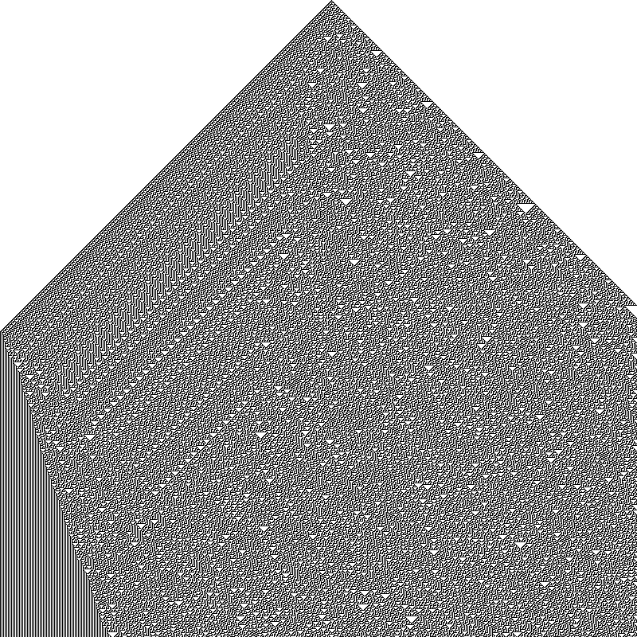
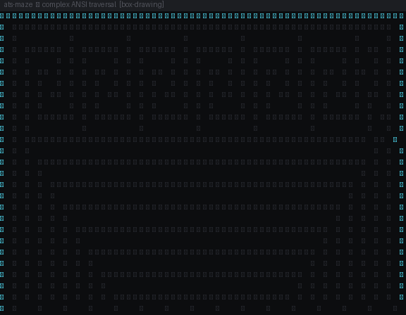

# z3-og

**A clean-stack remake of the original-style Z3** — the 2015-era
architecture (`util / ast / parsers / sat / smt / solver / shell`),
rebuilt from scratch: a custom SMT core, hand-rolled cryptography,
and a trusted OCaml kernel shipped as an opam package. No code was
copied from the projects that inspired it; the full provenance
record is in [SOURCES.md](SOURCES.md).





### What the maze is

A terminal-style visualizer of the ATS contract layer's geometry.
The walls are box-drawing characters (`┌─┐│└┘`) in cyan; the trail
is a color gradient (green visited, orange recent, yellow current)
matching the ANSI sequences the layer would emit if rendered live.
The path is a spiral through nested corridors — the same shape
discipline the contracts enforce on buffers: you only step where
the type says the cell exists, and the trail never crosses a wall.
It is not a solver output; it is the memory layout the contracts
describe, drawn so the bounds are visible.


*Rule 30 from a single seed, 800 × 800 generations, rendered from an
actual run of the `wolfram-flat` kernel in this repository — the
flat-array cellular automaton whose transition rules the solver can
also reason about symbolically (see [Flat-array layer](#flat-array-layer)).*

## Design principles

- **Hand-rolled, all of it.** The solver, the SHA-256/HMAC/Merkle
  crypto, and the kernel are original code written for this stack.
- **Never guess a verdict.** Any construct outside the decided
  fragment — arrays, floating point, quantifiers, `div`/`mod`,
  recursive definitions — poisons the problem and `check-sat`
  answers `unknown`. A partial problem is never solved as if it
  were the whole problem.
- **Exact arithmetic.** QF_LIA is decided over integers with exact
  rational bookkeeping (`__int128` intermediates). Rational
  feasibility is never confused with integer satisfiability:
  `2x + 3y = 12 ∧ x < y ∧ x > 0` is LIA-unsat, and the solver says so.
- **Verified by execution.** Every claim in this README is backed by
  a test that was run; the limits are stated as plainly as the
  results ([STATUS.md](STATUS.md)).

## Architecture


| Component | What it is |
|---|---|
| `src/` | SMT solver (C11, ~2,500 lines): SMT-LIB 2 parser → hash-consed AST → Tseitin encoding → DPLL SAT core → theory check per propositional model. Theories: congruence closure (QF_UF, incl. predicate congruence) + exact integer arithmetic (QF_LIA: Fourier–Motzkin feasibility, disequality backjumping, value-consistency learning). |
| `crypto/` | Hand-rolled cryptography (C11): SHA-256 (FIPS 180-4), HMAC-SHA256 (RFC 2104/4231), Merkle roots with domain separation and big-endian length serialisation. |
| `kernel-ocaml/` | The trusted kernel as an opam package: hash-consed terms with physical equality, occurs-checked substitution, a ground congruence-closure checker with sound disequality, and a hash-chained assertion log with tamper detection. |
| `wolfram-stack/wolfram/` | **Wolfram Language.** The owner's native `.wl` flat-array stack: 87 modules (Core/Array/Bits/Rules/Topology/Math/Bridge) — flat arrays, strides, indexing, bit packing, cellular automata, matrix ops, stencils, integer math, reductions — with assertion, property, and cross-language tests. |
| `wolfram-stack/wolfram-flat/` | **Rust.** The `no_std`, allocation-free binary-bit kernel (1D rules, 2D Moore, popcount) and its std process adapter speaking the hex-word protocol (`E`/`M`/`P`) that the Wolfram bridge modules call. Rust is Rust: a separate engine, tested separately. |
| `wolfram-stack/ats/` | **ATS.** The contract layer between the two: dependent-type memory/shape contracts over the kernel's buffers (length-indexed arrays, linear arena ownership, stencil bounds, C ABI bridge). Authored, not yet typechecked — see `wolfram-stack/ats/README.md`. |
| `dee-mirror/` + `crypto/og_mixcolumns.c` | Dee Mirror Maze: MixColumns as a braided loom in two fields — GF(2^8) AES weave + mirror inverse in verified C11, working team page (`dee-mirror/team.html`), Goldilocks F_p backend (det M = −35 ≢ 0 mod p, invertible). |
| `tools/rulec.c` | Symbolic rule compiler: turns a flat-array transition rule, unrolled over N steps, into Boolean SMT-LIB constraints the solver decides. |
| `fstar/` | The verified layer: F* modules under a zero-sorry rule (no `admit`, no vacuous lemmas), with KreMLin extraction to C99. |
| `docs/` | The v2 implementation contract (`ARCHITECTURE-CDCLT.md`) and the owner's reference sketches, filed verbatim. |

## Quickstart

```sh
make                                   # builds ./z3og (C11, no dependencies)
make test                              # solver self-tests: 13/13
sh tests/run_differential.sh           # differential vs a system z3, if present
sh tests/run_rulec.sh                  # rule-compiler verification: 5,120 checks
cd crypto && make test                 # crypto vectors: 14/14
cd kernel-ocaml && make test           # OCaml kernel: 35/35
```

```smt
(declare-const a Int)
(declare-const b Int)
(assert (= (+ (* 2 a) (* 3 b)) 12))
(assert (< a b))
(assert (> a 0))
(check-sat)   ; unsat — over the rationals this is satisfiable; over Int it is not
```

## Verified results

| Check | Result |
|---|---|
| Solver self-tests (known verdicts) | **13 / 13** |
| Differential vs system Z3 4.8.12, 81 corpus files | 38 agree, 40 `unknown`, 3 no-verdict, **0 mismatches** |
| Crypto published vectors (SHA-256, HMAC, Merkle) | **14 / 14** |
| OCaml kernel checks | **35 / 35** |
| Rule compiler, exhaustive at width 5 (every cell proved + refuted) | **5,120 / 5,120** solver checks |

The 40 `unknown` corpus answers are the poison rule and the theory
budgets working as designed — declining beats guessing.

## Benchmarks

Measured on the build machine (AMD EPYC 9D25, 2 vCPUs, gcc `-O2`);
full data, harnesses, and an honest reading in
[benchmarks/RESULTS.md](benchmarks/RESULTS.md).

- **Files both engines decide:** z3og 279 ms total vs Z3 1,599 ms —
  tiny instances, so this is mostly process startup and favours the
  small binary. Across all 81 files Z3 is far faster overall
  (4.0 s vs 30.6 s): on files z3og declines, it spends its budgets
  first. This baseline is a correctness engine, not a speed rival.
- **SHA-256:** 128.1 MiB/s (portable C, no hardware SHA).


## Flat-array layer

Three separate pieces, kept separate — Wolfram is Wolfram, Rust is
Rust, and the solver is the solver.

### Wolfram Language — `wolfram-stack/wolfram/`

The owner's native Wolfram Language implementation: 87 `.wl`
modules over flat lists and bit-packed `u64` words — strides and
ravel/unravel indexing, gather/scatter/scan, packed bit operations,
elementary and totalistic cellular automata, Conway Life, stencil
and matrix operations, integer mathematics and reductions. It ships
with explicit assertion tests, property tests, and a
cross-language test that compares its results against the Rust
adapter's. Run it with a Wolfram engine:
`wolframscript -file wolfram/RunTests.wl` (optionally with the
adapter path for the bridge tests).

### Rust — `wolfram-stack/wolfram-flat/`

A `no_std`, allocation-free Rust kernel over caller-owned `u64`
buffers (elementary rules, 2D Moore neighbourhoods, popcount), plus
a std process adapter that exposes it over a line-oriented hex
protocol (`E` = elementary step, `M` = Moore step, `P` = popcount).
The Wolfram bridge modules call this adapter; neither side pretends
to be the other. `cargo test`: 6 kernel tests + 5 adapter parser
tests. Bounded Kani harnesses are included in the source; they have
not been executed (see the stack's own README).

### Symbolic — `tools/rulec.c`

The rule compiler is the bridge to the solver: it compiles the same
elementary transition predicates into Boolean constraints, so the
solver can *prove* properties of the automaton (reachability, cell
values at generation t, invariant violations) instead of only
simulating it. The encoding is verified exhaustively at width 5
against an independent bit-serial reference (`tools/refstep.c`):
for every initial state, every cell's value is both proved and its
negation refuted, through the solver itself.

## Where this is going

The current engine is DPLL with batch theory checks. The locked v2
contract — [docs/ARCHITECTURE-CDCLT.md](docs/ARCHITECTURE-CDCLT.md) —
is a deterministic CDCL(T) solver on a bare-metal memory model:
strict C99 freestanding core, caller-supplied arenas with offsets
instead of pointers, zero allocation during propagation, rollback
congruence closure with explanation forests, exact QF_LIA through
the same theory interface, and proof certificates the OCaml kernel
checks independently (Boolean resolution steps, theory lemmas, the
final contradiction). One invariant governs the whole track: **no
`unsat` may be described as independently certified without a
successfully checked proof** — today the solver emits no proof
evidence, the kernel checks only directly supplied assertions, and
[STATUS.md](STATUS.md) says so in plain terms. The v2 engine
replaces the baseline only after the baseline's full battery plus
adversarial SAT instances, randomized CNF differential tests, and
proof replay are green.

## Scope and limits

Decided: propositional logic, QF_UF, QF_LIA, and their combination.
Not decided (answered `unknown`): QF_LRA beyond what exact integer
reasoning settles, bit-vectors, arrays, strings, floating point,
quantifiers, non-linear arithmetic. `get-model` prints declared
constants; uninterpreted function interpretations are not printed.
The kernel's assertion chain uses FNV-1a-64 as an *integrity* chain —
explicitly not a cryptographic hash; cryptographic anchoring is the
crypto layer's job, and the two are not yet wired together. Full
detail: [STATUS.md](STATUS.md).

## Provenance and license

Built from eight owner-supplied forks as architecture, design, and
test-data sources — what was taken from each, and under what
license, is recorded per fork in [SOURCES.md](SOURCES.md). The only
copied material in this repository is a subset of the z3test
regression corpus (`tests/corpus/`), which remains under its
original MIT license.

The hand-rolled code is licensed under the **Sovereign Leviathan /
SNAPKITTY OPAQUE SOURCE LICENSE v1.0** — see [LICENSE](LICENSE).
Commercial exploitation requires separate written authorisation;
publication, access, download, visibility, or possession is not
authorisation.
